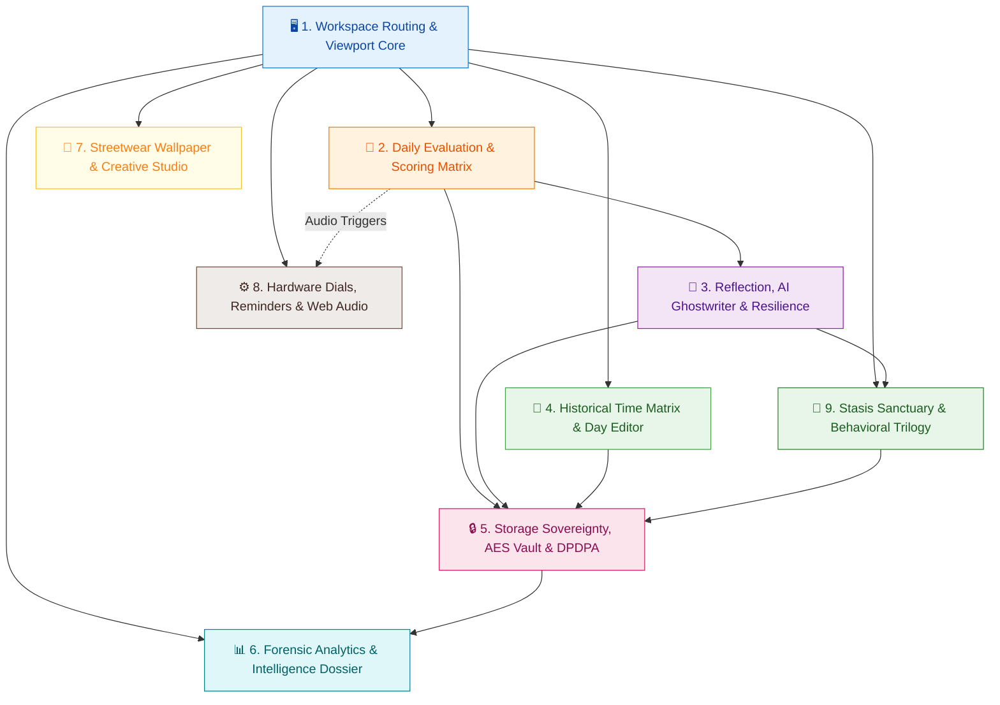
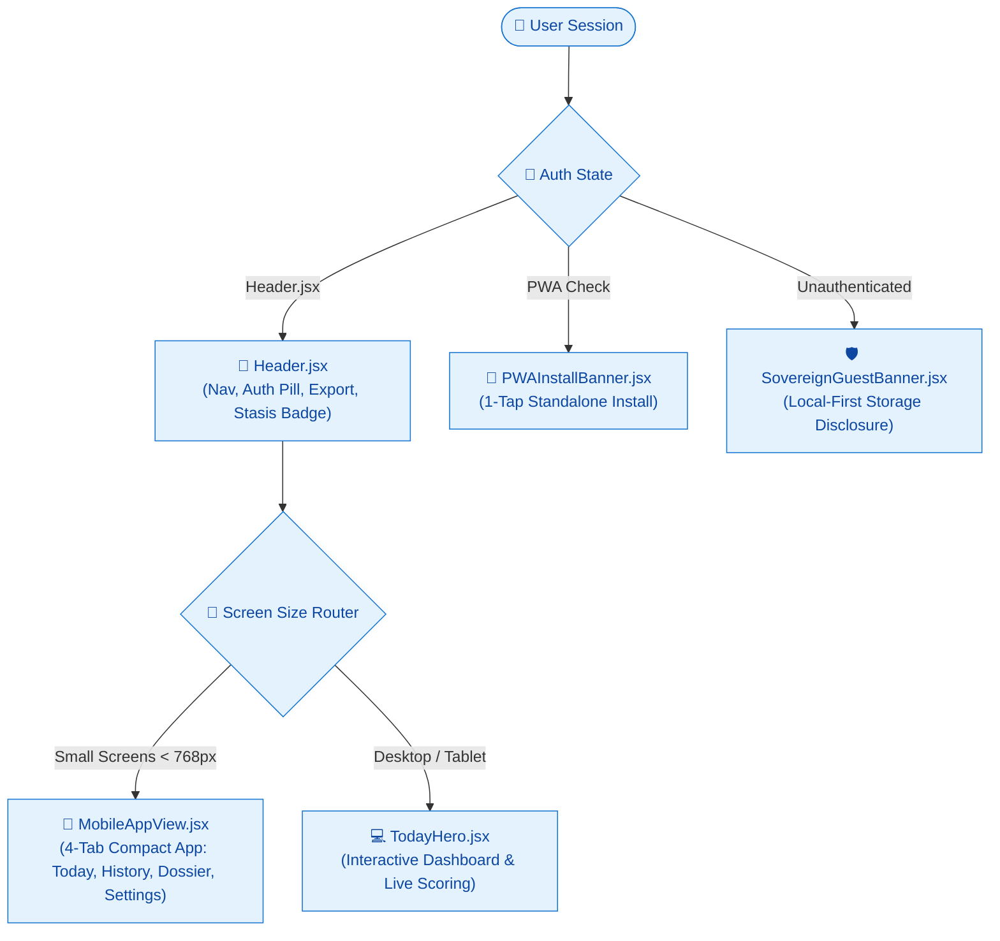
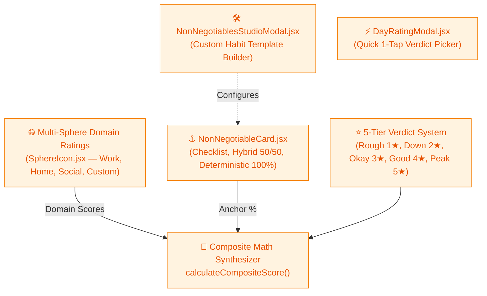
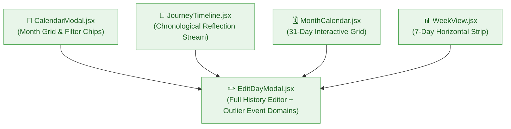
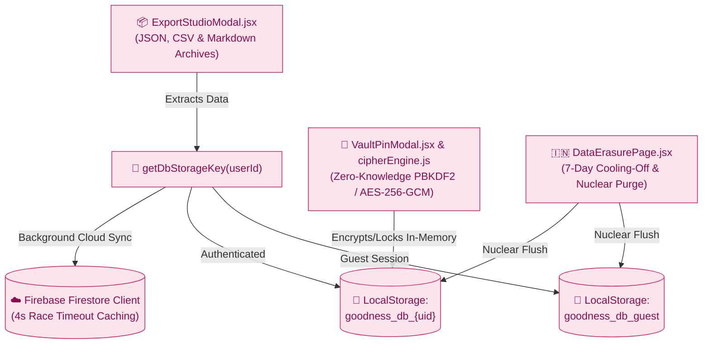
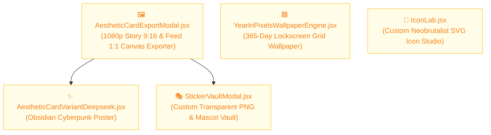
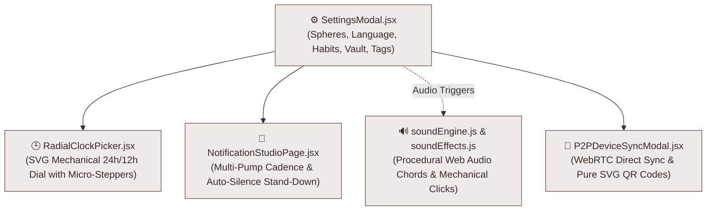
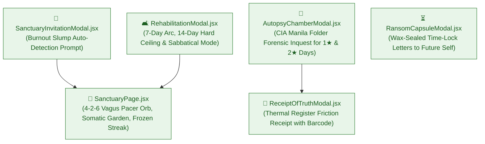

# DAILY VERDICT — Sovereign Behavioral Dossier & Habit Tracking Engine

> **The Neobrutalist Daily Life Logger, Habit Tracker & AI Performance Forensic Hub.**  
> Built on the principle of **Daily Accountability in 1 Second**, with 100% data sovereignty, offline-first PWA architecture, procedural Web Audio synthesizers, client-side AES-256 PIN encryption, stasis sanctuary streak freezing, an interactive SVG radial dial clock, and high-resolution streetwear poster exports.

---

## 🏛️ System Architecture

A complete, high-level map of the frontend client architecture and its interconnected component layers. Click any layer below to expand its dedicated component flowchart.



<details>
<summary><strong>🖥️ Layer 1 — Workspace Routing & Viewport Core</strong></summary>



**Feeds into:** Layer 2 (scoring), Layer 4 (calendar/timeline), Layer 6 (forensic dossier), Layer 7 (creative studio), Layer 8 (settings/audio), Layer 9 (sanctuary).

</details>

<details>
<summary><strong>🎯 Layer 2 — Daily Evaluation & Scoring Matrix</strong></summary>



**Receives from:** Layer 1 (Mobile/Desktop View). **Feeds into:** Layer 3 (composite score → reflection/slump trigger), Layer 5 (score → client storage write), Layer 8 (audio triggers).

</details>

<details>
<summary><strong>📝 Layer 3 — Reflection, AI Ghostwriter & Cognitive Resilience</strong></summary>

```mermaid
%%{init: {'flowchart': {'nodeSpacing': 40, 'rankSpacing': 60, 'curve': 'basis'}}}%%
flowchart TD
    AutoTextarea["✍️ AutoExpandTextarea.jsx<br/>(Smart Diary Input & Character Counter)"]
    AiGhostwriter["🤖 AI Diary Ghostwriter<br/>(First-Person Stoic Polish Engine)"]
    QuotePeeler["🧼 Multi-Pass Peeling Pipeline<br/>cleanAiEnhancedText()"]
    DistortionScanner["🔍 CognitiveDistortionScanner.jsx<br/>(Real-Time Thinking Trap Detection)"]
    ReactionBanner["🎭 MoodReactionBanner.jsx<br/>(Streetwear Mascot & Live Stoic Directives)"]
    RecoveryModal["🚨 MotivationalRecoveryModal.jsx<br/>(2-Day Slump Interceptor & Stoic Protocol)"]

    AutoTextarea --> AiGhostwriter
    AiGhostwriter --> QuotePeeler
    AutoTextarea --> DistortionScanner
    ReactionBanner
    RecoveryModal

    classDef l3 fill:#F3E5F5,stroke:#8E24AA,color:#4A148C
    class AutoTextarea,QuotePeeler,DistortionScanner,ReactionBanner,RecoveryModal l3
    class AiGhostwriter fill:#D1C4E9,stroke:#5E35B1,color:#311B92,stroke-dasharray: 5 5;
```

**Receives from:** Layer 2 (Composite Math Synthesizer drives `ReactionBanner`, and triggers `RecoveryModal` on consecutive rough days). **Feeds into:** Layer 5 (diary notes → client storage), Layer 9 (slumps trigger Autopsy Chamber and Ransom Capsules).

</details>

<details>
<summary><strong>📅 Layer 4 — Historical Time Matrix & Day Editing</strong></summary>



**Receives from:** Layer 1 (Header nav → Calendar; Mobile view → Timeline; Desktop view → Week). **Feeds into:** Layer 5 (Edit Day Modal → client storage write).

</details>

<details>
<summary><strong>🔒 Layer 5 — Storage Sovereignty, AES Vault & DPDPA Compliance</strong></summary>



**Receives from:** Layers 2, 3, 4 & 9 — all writes funnel through `getDbStorageKey()`. **Feeds into:** Layer 6 (stored data → telemetry & dossiers).

</details>

<details>
<summary><strong>📊 Layer 6 — Forensic Analytics & Intelligence Dossier</strong></summary>

```mermaid
%%{init: {'flowchart': {'nodeSpacing': 40, 'rankSpacing': 60, 'curve': 'basis'}}}%%
flowchart TD
    StatsWidget["⚡ StatsWidget.jsx<br/>(Lifetime Metrics Pill)"]
    ForensicModal["📈 ForensicStatsModal.jsx<br/>(Hit Rate, Streak Counter, Slump Curves)"]
    AnalyticsPanel["📉 AnalyticsPanel.jsx<br/>(Weekday Velocity Charting)"]
    MonthlyDossierModal["🧠 MonthlyReportModal.jsx<br/>(Homie Letters, Archetypes, Velocity Curves)"]

    StatsWidget --> ForensicModal
    ForensicModal --> AnalyticsPanel
    MonthlyDossierModal

    classDef l6 fill:#E0F7FA,stroke:#00838F,color:#006064
    class StatsWidget,ForensicModal,AnalyticsPanel l6
    class MonthlyDossierModal fill:#D1C4E9,stroke:#5E35B1,color:#311B92,stroke-dasharray: 5 5;
```

**Receives from:** Layer 1 (Header shortcuts), Layer 5 (stored history data).

</details>

<details>
<summary><strong>🎨 Layer 7 — Streetwear Wallpaper & Creative Studio</strong></summary>



**Receives from:** Layer 1 (Header nav shortcuts), Layer 2 (daily rating), Layer 4 (reflection data).

</details>

<details>
<summary><strong>⚙️ Layer 8 — Hardware Dials, Reminders & Web Audio</strong></summary>



**Receives from:** Layer 1 (Header nav → Settings), Layer 2 (tactile audio triggers).

</details>

<details>
<summary><strong>🌿 Layer 9 — Stasis Sanctuary & Behavioral Trilogy</strong></summary>



**Receives from:** Layer 2 & 3 (Slump triggers open Autopsy Chamber, Ransom Capsule unlocks, or suggests Sanctuary). **Feeds into:** Layer 1 (Stasis badges) & Layer 5 (frozen state persistence).

</details>

---

## 📖 Table of Contents

1. [🏛️ System Architecture](#system-architecture)
2. [⚡ Core Philosophy & Behavioral Science](#core-philosophy--behavioral-science)
3. [🎭 The 5 Verdict Tiers & Mascot Lore](#the-5-verdict-tiers--mascot-lore)
4. [🌿 Tranquility Sanctuary & Grand Sabbatical (Life Pause & Streak Shield)](#tranquility-sanctuary--grand-sabbatical-life-pause--streak-shield)
5. [🏛️ The Behavioral Trilogy & Forensic Inquests](#the-behavioral-trilogy--forensic-inquests)
6. [🕒 The Interactive Radial Dial Clock & Notification Studio](#the-interactive-radial-dial-clock--notification-studio)
7. [🌐 Segmented Day Matrix & Multi-Sphere Classification](#segmented-day-matrix--multi-sphere-classification)
8. [⚓ Non-Negotiable Habits & Anchor System](#non-negotiable-habits--anchor-system)
9. [🖼️ Wallpaper Studio & Streetwear Poster Engine](#wallpaper-studio--streetwear-poster-engine)
10. [🤖 AI Diary Ghostwriter & Language Isolation](#ai-diary-ghostwriter--language-isolation)
11. [📊 Monthly AI Performance Forensic Dossier](#monthly-ai-performance-forensic-dossier)
12. [🔐 Client-Side Zero-Knowledge AES-256 Vault](#client-side-zero-knowledge-aes-256-vault)
13. [🇮🇳 Statutory Indian DPDPA 2023 Right-to-be-Forgotten & Export Studio](#statutory-indian-dpdpa-2023-right-to-be-forgotten--export-studio)
14. [📱 320px Ultra-Compact Mobile Architecture & Neobrutalist UI Standard](#320px-ultra-compact-mobile-architecture--neobrutalist-ui-standard)
15. [🔊 Procedural Web Audio Engine (0 KB External Audio)](#procedural-web-audio-engine-0-kb-external-audio)
16. [📡 Decentralized Peer-to-Peer Device Sync](#decentralized-peer-to-peer-device-sync)
17. [🛡️ Offline-First Architecture & Multi-User Isolation](#offline-first-architecture--multi-user-isolation)
18. [🤖 Master Automated System Audit Suite](#master-automated-system-audit-suite)
19. [📱 Installing as a Native Mobile App (PWA)](#installing-as-a-native-mobile-app-pwa)
20. [⌨️ Developer CLI Tooling](#developer-cli-tooling)
21. [🚀 Quick Start & Frontend Tech Stack](#quick-start--frontend-tech-stack)

---

## ⚡ Core Philosophy & Behavioral Science

Most productivity systems and habit apps fail because they demand unsustainable cognitive overhead: checking 30 checkboxes, grading complicated metrics, and treating your life like an enterprise spreadsheet.

**SHIT OR HIT** is built on a single, uncompromising truth: **Brutal Daily Accountability in 1 Second.**

Every night before sleep, you deliver an honest verdict on your day: was it a **HIT** or was it **SHIT**? You rate your performance on a 5-tier scale, jot down unfiltered diary notes about what actually transpired, and let the system transform your raw days into:

- **Forensic Heatmaps & Weekday Velocity Curves**: Instantly spot which weekdays drain you (e.g. cursed Thursdays) and when your momentum peaks.
- **Streetwear Story Posters & Lockscreen Art**: Turn your daily struggle or victory into 1080p high-fashion graphic posters.
- **Unfiltered Homie AI Intelligence**: Receive brutally honest, deeply caring evaluations from a best-friend AI persona that roasts your self-sabotage and passionately hypes your comebacks.
- **Burnout Circuit Breakers**: Automatically freeze streaks and enter a restorative sanctuary when life demands rest, preventing toxic guilt spirals.

---

## 🎭 The 5 Verdict Tiers & Mascot Lore

Every rating tier is tied to a distinct streetwear mascot archetype, visual color palette, and psychological directive:

| Rating | Tier Name | Color Token | Mascot Archetype | Core Vibe & Directive |
| :--- | :--- | :--- | :--- | :--- |
| **1★** | **Rough (Shit)** | `#FF4D4D` (Crimson) | **Cooked Goblin 👺** | Red-alert friction, chaos, lost battles, 3:45 AM dopamine traps. *"Trench survivor. Tomorrow we reset."* |
| **2★** | **Down** | `#FF8A00` (Orange) | **Low-Battery Zombie 🧟** | 23% battery remaining, brain fog, fatigue, sluggish execution. *"Low energy, but still standing."* |
| **3★** | **Okay** | `#CBD5E1` (Slate) | **Stoic Sustainer 🦥** | Steady maintenance, held the defensive line, baseline output. *"Discipline over motivation. Baseline held."* |
| **4★** | **Good** | `#00E599` (Emerald) | **Flow Warrior Beast ⚡** | Sharp focus, dialed-in execution, clean wins, zero procrastination. *"High velocity locked in."* |
| **5★** | **Peak (Hit)** | `#FDC800` (Gold) | **God Mode Demon 👑** | Total flow state, clutch breakthroughs, legendary dominance. *"Unstoppable momentum. Total mastery."* |

### Archetype Breakdown

#### 1★ Rough — The Cooked Goblin 👺
- **When to Log**: You gave into doomscrolling, failed a critical exam, skipped workouts, or let the day slip into chaos.
- **Psychological Function**: Validates the pain and eliminates guilt so you can clear the slate and execute the next morning.

#### 2★ Down — Low-Battery Zombie 🧟
- **When to Log**: You showed up, but felt exhausted, uninspired, or physically drained.
- **Psychological Function**: Flags energy leaks, sleep deprivation, or impending burnout before it morphs into a multi-day slump.

#### 3★ Okay — The Stoic Sustainer 🦥
- **When to Log**: An unglamorous day of routine duty where you didn't conquer the world, but you didn't give up ground either.
- **Psychological Function**: Celebrates the quiet consistency that builds compounding lifetime momentum.

#### 4★ Good — The Flow Warrior Beast ⚡
- **When to Log**: You crushed your tasks, stayed off distracting apps, and made meaningful progress toward your core goals.
- **Psychological Function**: Reinforces positive friction-free workflows and locks in productive habits.

#### 5★ Peak — The God Mode Demon 👑
- **When to Log**: Everything clicked. You clutched a major milestone, worked with surgical precision, and delivered a massive win.
- **Psychological Function**: Immortalizes your highest achievements and fuels your belief in what you are capable of.

---

## 🌿 Tranquility Sanctuary & Grand Sabbatical (Life Pause & Streak Shield)

Habit apps notoriously cause toxic anxiety when illness, exams, travel, or burnout strike. **SHIT OR HIT** introduces two dedicated, scientifically designed stasis modes that freeze and shield your hard-earned streak while providing restorative somatic tools.

### 1. Tranquility Sanctuary (Acute 7-Day to 14-Day Reset)
Designed for emergency nervous system triage, exam preparation, or physical illness:
- **Duration Constraints**: Structured 7-day arc with an immutable hard ceiling of 14 days (`Math.min(14, freezeDays)`).
- **Vagus Nerve 4-2-6 Pacer Orb**: A procedural visual breathing guide expanding and contracting smoothly (`Inhale 4s` ➔ `Hold 2s` ➔ `Exhale 6s`) to trigger parasympathetic tone recovery.
- **Somatic Grounding Garden**: Physical anchor check-ins with clean vector SVG icons:
  - `Droplets` (Hydration check)
  - `Footprints` (15-minute nature walk)
  - `Moon` (8-hour restorative sleep)
  - `PhoneOff` (Digital detox / dopamine fasting)
- **7-Day Pebble Beads**: Tactile visual progress beads marking your restorative progress without pressure.
- **Proactive Burnout Prompt**: If the system detects consecutive 1★ and 2★ rough days, it proactively presents a gentle Sanctuary invitation modal to prevent catastrophic relapse.

### 2. Grand Sabbatical (Macro Open-Ended Pause)
Designed for major life transitions: world travel, creative sabbaticals, gap years, or intensive career pivots:
- **Open Horizon**: Zero deadline pressure. The streak shield badge displays: `DAY X • OPEN HORIZON • STREAK SHIELDED & FROZEN`.
- **No Daily Checklists**: Completely suppresses daily rating requirements, eliminating the toxic feeling of falling behind.
- **Sabbatical Chronicles**: Freeform journaling area for recording high-level reflections, travel memoirs, and philosophical shifts without generating scores or grades.

---

## 🏛️ The Behavioral Trilogy & Forensic Inquests

Three specialized psychological tools help you diagnose failure, seal time-locked commitments, and confront objective reality.

### 1. Post-Mortem Autopsy Chamber (`AutopsyChamberModal.jsx`)
Triggered automatically or manually for **1★ Rough** and **2★ Down** days:
- **CIA Manila Folder Aesthetic**: Styled like a confidential government dossier with forensic stamps and inspection tabs.
- **Forensic Diagnosis Questionnaire**: Rapid diagnostic prompts that interrogate:
  1. *Primary Friction Catalyst* (Social media trap, emotional conflict, physical fatigue, avoidance).
  2. *Sleep & Energy Deficit* (Hours slept, bedtime delay, caffeine crash).
  3. *Immediate Trigger* (The exact 15-minute window where discipline dissolved).
- **Binding Protocol Commitment**: Requires user to select a concrete recovery protocol for the next morning before closing the inquest.

### 2. Ransom Time-Lock Capsule (`RansomCapsuleModal.jsx`)
A cryptographic letter to your future self sealed with visual red wax:
- **Sealing Mechanism**: Write confidential encouragement, warnings, or raw honesty when in flow state or after a profound lesson.
- **3 Dynamic Unlocking Triggers**:
  - **Calendar Date**: Unlocks on a specific future birthday, exam day, or milestone.
  - **Slump Detection**: Automatically breaks wax seal if you log 2 consecutive rough days, delivering timely tough-love when you need it most.
  - **Milestone Streak**: Unlocks when reaching an extraordinary streak milestone (e.g. 7, 30, or 100 days).

### 3. Thermal Receipt of Truth (`ReceiptOfTruthModal.jsx`)
- **Streetwear Register Receipt**: Transforms your daily habit execution, sphere balance, and dopamine friction into a tangible thermal paper receipt.
- **Itemized Audit**: Features mono typography, tear-off zigzag borders, authentic vector barcodes, and a bottom summary totaling execution efficiency vs dopamine leakage.

### 4. Cognitive Distortion Scanner (`CognitiveDistortionScanner.jsx`)
- Built-in real-time reflection scanner that analyzes diary entries as you type.
- Detects and highlights 4 core cognitive traps:
  - *All-or-Nothing Thinking* ("Everything was completely ruined").
  - *Catastrophizing* ("I will never recover from this").
  - *Overgeneralization* ("I always mess this up").
  - *Emotional Reasoning* ("I feel sluggish, therefore I am lazy").

---

## 🕒 The Interactive Radial Dial Clock & Notification Studio

The **Radial Dial Clock** replaces clunky dropdowns and standard text inputs with an analog-inspired SVG circular drag dial engineered with subpixel trigonometry.

### Step-by-Step Dial Workflow

1. **Accessing the Clock**:
   - Open **⚙️ App Settings** from the navigation bar.
   - Under **Daily Streak Reminder**, tap the **DIAL** button to summon the radial dial modal.

2. **Step 1 — Dialing the Hour (1 to 12)**:
   - The clock opens in **Hour Mode** displaying numbers 1 through 12 in high-voltage gold (`#FDC800`).
   - Touch or drag the glowing indicator pointer around the dial to select your target hour (e.g. `10`).

3. **Step 2 — Automatic Teleportation**:
   - The moment you release your finger or mouse cursor on an hour, the dial **automatically teleports into Minute Mode** after a smooth 300ms transition.

4. **Step 3 — Selecting Exact Minutes (Continuous Drag + Micro Steppers)**:
   - The dial transitions to emerald neon (`#00E599`) with 60 minute intervals (00 to 59).
   - Drag smoothly around the circumference to pick your minute, or use the **`[ - ]`** and **`[ + ]`** micro-steppers beside the digital readout to dial exact minutes like `10:47`, `10:38`, or `09:23`.

5. **Step 4 — AM / PM Selection & Activation**:
   - Tap the **AM** or **PM** chip.
   - Tap **`[ SET REMINDER TIME ]`**. The application registers a persistent local notification schedule that triggers every evening without draining background battery.

### Notification Studio (`NotificationStudioPage.jsx`)
- **Multi-Pump Evening Reminders**: Schedules non-intrusive reminder alerts tailored to your sleeping schedule.
- **Auto-Silence Stand-Down**: Automatically silences reminders the moment today's verdict is logged, ensuring zero spam.
- **Quiet Hours & Mechanical Sound Profiles**: Choose between procedural typewriter clicks, mechanical switch snaps, or silent push notifications.

---

## 🌐 Segmented Day Matrix & Multi-Sphere Classification

For deep behavioral tracking, users can enable **Segmented Day Matrix (Multi-Sphere Classification)** from **⚙️ App Settings**.

### Why Multi-Sphere Logging?
A single master rating can sometimes oversimplify contrasting days (e.g. having a 4★ / 5★ victory in classes/office followed by a 1★ chaotic evening at home). Segmented classification lets you isolate and evaluate each life domain:

| Sphere ID | Life Domain | Default Vector Icon | Focus Scope |
| :--- | :--- | :--- | :--- |
| `work_school` | **Work & School** | `GraduationCap` / `Building2` | Academics, office execution, exams & deep productivity |
| `home_personal` | **Home & Sanctuary** | `Home` / `Armchair` | Household peace, family dynamics, evening chores & rest |
| `social_event` | **Social & Events** | `PartyPopper` / `Users` | Gatherings, parties, outings, and friend interactions |
| *Custom* | **User-Defined Spheres** | `Dumbbell` / `Rocket` / `Code` | Fitness, side hustles, coding sprints, creative arts, etc. |

### Core Matrix Capabilities:
- **🎛️ Settings Sphere Manager**: Toggle individual default spheres on/off and create unlimited custom spheres with custom vector icons and accent colors.
- **⚡ Real-Time Composite Velocity Score**: Blends active sphere scores mathematically (e.g. `2.7★ Okay`), updating the day's master verdict while preserving domain clarity.
- **💻 Desktop PC Life Matrix Grid**: Interactive multi-card layout with instant mini rating rows, expandable micro-notepads per sphere, and unified AI ghostwriter synthesis.
- **📱 Mobile Haptic Segmented Bar**: Smooth horizontal pill switcher with spring physics, native vibration feedback, and quick notes.
- **📊 Forensic Analytics Matrix**: Automatic aggregate domain statistics in the Forensic Telemetry modal (`Avg Work/School vs Home vs Social`).

---

## ⚓ Non-Negotiable Habits & Anchor System

Users can configure daily non-negotiable habits with 3 distinct rating algorithms:

| Habit Mode | Scoring Mechanism | Ideal For |
| :--- | :--- | :--- |
| **Deterministic 100%** | Day score is governed **100% mathematically** by habit completion percentage (0% done = 1★ Rough, 100% done = 5★ Peak). Manual 1-tap rating buttons are locked. | Hardcore routines, exam cram periods, discipline bootcamps. |
| **Hybrid 50/50** | Blends subjective emotional feeling (50%) with mathematical habit completion (50%). | Balanced lifestyle, holistic reflection, structured accountability. |
| **Checklist Mode** | Habits serve as a daily checklist while preserving manual 1-tap subjective verdicts. | Flexibility, daily mindfulness, low-stress tracking. |

### Habit Studio Modal (`NonNegotiablesStudioModal.jsx`)
- Create, reorder, edit, and categorize custom anchors.
- Pre-built presets: *Morning Hydration, 100 Pushups, 4-Hour Deep Work Block, No Phone Before Sleep, Daily Reading*.

---

## 🖼️ Wallpaper Studio & Streetwear Poster Engine

The **Wallpaper Studio** enables you to turn any day's raw verdict and journal reflection into high-res (1080p) graphic streetwear artwork.

### Poster Anatomy & Visual Elements

| Component Section | Visual Display Content | Design Purpose |
| :--- | :--- | :--- |
| **Top Header Tape** | `⚡ SHIT OR HIT OS` • `THURSDAY, AUG 27` • `DAY 8` | High-contrast status banner & current streak day badge |
| **Rating Hero** | `★★★★★` + `OKAY` + `SCORE: 3.0 / 5.0` | Large bold typography with color-coded rating stars |
| **Central Spotlight** | Streetwear Mascot or Custom Uploaded Sticker | Focal artwork with ambient drop shadow & glow |
| **Directive Banner** | `⚡ DAILY DIRECTIVE: BASELINE HELD. DISCIPLINE OVER MOTIVATION.` | High-impact psychological takeaway for the day |
| **Telemetry Pills** | `[ STREAK: 8 DAYS ]` `[ SCORE: 3.0/5.0 ]` `[ STOIC SUSTAINER ]` | Grid of 3 key quantitative momentum metrics |
| **Security Footer** | `LOGGED BY TRINNO • SHIT OR HIT` + Vector Barcode | Authentic streetwear aesthetic & developer identity watermark |

### Core Features

- **Dual Export Ratios**:
  - **📱 Story Poster (`9:16` — 1080 × 1920)**: Full-bleed vertical poster ideal for phone lockscreens, wallpapers, and Instagram / WhatsApp Stories.
  - **🖼️ Feed Card (`1:1` — 1080 × 1080)**: Square format optimized for Discord statuses, X/Twitter posts, and square progress cards.
- **3 Streetwear Color Themes**:
  - **Gold & Yellow**: High-voltage streetwear contrast with halftone polka-dot background textures.
  - **Obsidian Cyberpunk**: Carbon matrix grid lines with glowing neon teal spotlights.
  - **Crimson Sunset**: Deep purple and neon amber gradients for night owls.
- **🟩 365-Day Year in Pixels Wallpaper Generator (`YearInPixelsWallpaperEngine.jsx`)**:
  - Exports a dense, high-resolution full-year pixel grid lockscreen displaying all 365 days color-coded by verdict.
- **🎭 Custom Sticker Vault (`StickerVaultModal.jsx`)**: Upload transparent PNG stickers, memes, or avatars to replace default mascots.
- **🔬 Icon Lab (`IconLab.jsx`)**: In-app Neobrutalist vector SVG icon designer and generator.

---

## 🤖 AI Diary Ghostwriter & Language Isolation

Writing diary reflections late at night can be messy. The built-in **AI Ghostwriter** converts raw, rapid stream-of-consciousness thoughts into structured, insightful first-person journal entries.

### Ghostwriting Rules

- **Strict 1st-Person Perspective**: Writes entirely from your perspective (`"I"`, `"my"`, `"myself"`), never speaking down or acting like a corporate bot.
- **Zero Compression Guarantee**: Preserves 100% of names, test scores, conversations, emotional friction, and specific events in full narrative depth.
- **Multi-Pass Peeling Pipeline (`cleanAiEnhancedText`)**:
  - LLMs often output surrounding quotation marks, markdown code fences, date stamps (`October 15, 2026\n\n`), or stray boundary commas (`,"..."`).
  - The client runs up to 5 iterative passes stripping fences, date stamps, and outer quotation marks while strictly preserving internal quotes (dialogue, book titles).

### Multilingual Isolation Modes (Configurable in Settings)

- **`⚡ Auto-Match (Default)`**: Automatically detects whether your input notes are in English or Hinglish and mirrors that exact dialect.
- **`🇬🇧 English Only`**: Strictly mandates 100% polished, high-impact English across all reflections and monthly dossiers with zero Hindi/Hinglish words.
- **`🇮🇳 Hinglish`**: Crafts authentic, natural, conversational Hinglish (Hindi in Roman script) with authentic bro expressions.

---

## 📊 Monthly AI Performance Forensic Dossier

At the end of every month, tap **📊 Monthly AI Dossier** to generate an exhaustive behavioral analysis of your monthly habit trajectory.

### Dossier Components

1. **💬 The Homie Letter (4 Structured Paragraphs)**:
   - *Paragraph 1 (Reality Check & Validation)*: Acknowledges hardships, failed tests, burnout, and emotional fatigue.
   - *Paragraph 2 (Unfiltered Roasting of Dopamine Traps)*: Calls out self-inflicted wounds (Reels insomnia, 3:45 AM loops, procrastination).
   - *Paragraph 3 (The Clutch Breakdown)*: Hypes your logging consistency and celebrates pivotal redemption days.
   - *Paragraph 4 (Brotherly Game Plan)*: Provides concrete, practical advice for the upcoming month.
2. **🔍 6 Sharp Behavioral Observations**: Discovers hidden correlations (e.g. 1.5 average cursed Thursdays, caffeine crashes, clutch streaks).
3. **📈 Weekday Velocity Horizon Visualizer**: Visual bar chart comparing momentum across Sunday through Saturday.
4. **🔥 Friction Root-Cause Leak Breakdown**: Keyword analysis measuring screen doomscrolling %, academic/work stress %, and social friction %.
5. **Persistent Storage & Language Isolation**: Evaluated dossiers are cached in client storage by language key (`report_real_2026_08_english`), loading instantly with zero latency.

---

## 🔐 Client-Side Zero-Knowledge AES-256 Vault

Your private thoughts and confessions should never be accessible in plain text.

- **Web Crypto API Standard**: Uses native, browser-hardware-accelerated cryptography.
- **PBKDF2 Key Derivation**: Derives encryption keys from your 4-digit PIN using **100,000 rounds of PBKDF2 with unique cryptographic salt**.
- **AES-GCM 256-bit Encryption**: Encrypts diary reflections client-side in browser RAM before writing to `localStorage` or cloud databases.
- **Zero-Knowledge Architecture**: Plaintext notes are never stored unencrypted. Even if an attacker reads your disk or storage, your diary reflections remain an unreadable cipher.
- **Auto-Lock Timer & Brute-Force Gatekeeper**: Automatically re-locks the vault upon idle timeout or window closure.

---

## 🇮🇳 Statutory Indian DPDPA 2023 Right-to-be-Forgotten & Export Studio

Built from the ground up to respect user data sovereignty and comply with Sections 12 & 13 of the **Digital Personal Data Protection Act (DPDPA 2023)**.

### 1. Data Erasure Portal (`DataErasurePage.jsx`)
- **7-Day Regret-Proof Cooling-Off Period**: When an account deletion is initiated, it enters a 7-day safety holding period. If the decision was made in an emotional low, you can click **Cancel Erasure Request** at any point within the 7 days.
- **Nuclear Purge**: Upon confirmation or timer expiry, the client executes an irreversible purge wiping all local storage keys (`goodness_db_*`), indexed records, cached dossiers, and cloud bindings.

### 2. Export Studio (`ExportStudioModal.jsx`)
- **100% Data Portability**: Export your complete historical dataset at any time with zero vendor lock-in.
- **3 Supported Export Formats**:
  - **Raw JSON**: Complete schema backup for migration or programmatic inspection.
  - **Structured CSV**: Spreadsheet-ready table containing dates, numerical scores, spheres, and habit percentages.
  - **Markdown Diary Digest**: A beautifully formatted book of all your daily journal entries with dates, headers, and bullet points.

---

## 📱 320px Ultra-Compact Mobile Architecture & Neobrutalist UI Standard

Every view in the application is engineered to operate seamlessly on tiny screens and adhere to strict Neobrutalist design engineering.

### 1. 320px Baseline Viewport Standard
Every modal, drawer, view, and card is tested and verified on **320px × 498px** (the industry baseline smallest mobile viewport) with zero horizontal scroll and zero text truncation.

### 2. The Golden Vertical Stacking Law
On mobile screens (`< sm`), interactive action footers **strictly stack vertically** (`flex-col sm:flex-row`).
- **Primary Action (Top)**: Full-width (`w-full`) for effortless thumb tapping.
- **Secondary Actions (Bottom)**: Stacked cleanly underneath or split 50/50, leaving ample breathing space.

### 3. In-Place Tactile State Morphing (Zero CLS)
To prevent disruptive Cumulative Layout Shift (CLS), action buttons morph their internal state in-place:
- `POLISHING...` (Spinning Lucide `Loader2` during async processing).
- `POLISHED!` (Emerald Lucide `Check` for 1.8s upon success).
- `FAILED (RETRY)` (Coral Lucide `AlertCircle` with tactile retry button).

### 4. Ink Overflow & Subpixel Glyph Clipping Prevention
In geometric display fonts, short 1-word verdict labels (`GOOD`, `PEAK`, `ROUGH`) can have subpixel overhangs that get clipped by hardware rasterizers if styled with `truncate`. The app strictly enforces:
```jsx
className="... font-display font-black uppercase tracking-normal leading-none whitespace-nowrap overflow-visible px-0.5"
```

### 5. Persistent Drawer Dismissal Memory
Dismissing the daily reflection drawer in `TodayHero` persists the user's intent in `localStorage` keyed by date (`daily_verdict_note_closed_${todayStr}`). The drawer will never aggressively re-open on component remount unless explicitly summoned.

### 6. Strict Neobrutalist Design Tokens
- **Borders**: Solid black borders (`border-2 border-black` / `border-3 border-black`).
- **Shadows**: Offset drop shadows without blur (`shadow-[2px_2px_0px_#000]`, `shadow-[3px_3px_0px_#000]`).
- **Tactile Feedback**: Active button depression (`active:translate-x-px active:translate-y-px active:shadow-none`).
- **Palette**: Gold (`#FDC800`), Emerald (`#00E599`), Coral Red (`#FF4D4D`), Warm Cream Background (`#FFFDF8`).
- **Zero Raw Emojis in UI**: Pure Lucide React vector icons paired with bold uppercase typography.

---

## 🔊 Procedural Web Audio Engine (0 KB External Audio)

The application features a built-in procedural Web Audio synthesizer (`soundEngine.js` & `soundEffects.js`):
- **0 KB Asset Footprint**: Uses zero external MP3, WAV, or OGG audio files.
- **Synthesized Chords**: Real-time Web Audio API oscillators generating 5 harmonic mood chords matching your verdict tier (from a low somber chord on 1★ Rough to an energetic triumphant chord on 5★ Peak).
- **Mechanical Haptics**: Synthesizes tactile mechanical keyboard clicks, switch snaps, and camera shutter sounds with sub-millisecond audio response.

---

## 📡 Decentralized Peer-to-Peer Device Sync

Sync your diary between your phone and laptop without relying on cloud servers.
- **WebRTC Direct Data Channel**: Establishes an encrypted peer-to-peer data tunnel between devices.
- **Pure JavaScript SVG QR Generator (`qrGenerator.js`)**: Generates crisp, zero-dependency SVG QR codes on-the-fly for instant camera pairing.
- **End-to-End Encrypted Handshake**: Transfers history and preferences directly device-to-device.

---

## 🛡️ Offline-First Architecture & Multi-User Isolation

Your data belongs entirely to you. SHIT OR HIT combines instant local performance with cloud backup:

```
[ User Interaction ] ──▶ [ Sub-1ms Optimistic UI ] ──▶ [ LocalStorage goodness_db_* ]
                                 │
                                 └──▶ [ 4s Race Async Sync ] ──▶ [ Firebase Firestore Client ]
```

1. **Sub-1ms Optimistic Mutations**:
   - Every rating change and journal note saves immediately to local state and browser `localStorage`.
   - The application works 100% offline without requiring an active internet connection.
2. **4-Second Cloud Sync Race Timeout**:
   - When signed in with Google, entries sync to Firebase Firestore asynchronously.
   - If your network drops or lags, the save operation times out after 4 seconds and queues locally, preventing the UI from freezing.
3. **Multi-User Isolation & Instant Logout Memory Flush**:
   - Local database partitions dynamically per user (`goodness_db_${uid}` vs `goodness_db_guest`).
   - Logging out triggers a clean in-memory React state reload (`window.location.reload()`), immediately flushing cached telemetry and diary entries.

---

## 🤖 Master Automated System Audit Suite

The application includes a built-in automated test suite covering all **67+ components, math engines, stasis protocols, audio synthesizers, and security layers** with **88 passing audits | 0 failures**.

```bash
# Run the 15-suite master audit anytime:
npm run audit
```

### 15 Master Test Suites Included:
1. **Core Navigation & Views**: Validates Header sliding pill, mobile radio ratings, persistent reflection drawer memory, and PWA install handlers.
2. **Calendar Matrix & Day Editor**: Verifies date click matrix bindings and outlier event domain injection.
3. **Forensic Analytics & Telemetry**: Tests hit rates, streak algorithms, and slump progression formulas.
4. **Monthly Dossier Intelligence**: Asserts executive summaries, homie letters, and on-demand AI re-evaluations.
5. **Creative Studio & Wallpapers**: Tests 4K canvas rasterization and 365-day pixel grid generators.
6. **Sticker & Mascot Vault**: Validates custom sticker uploads, tag categorizations, and deletion pipelines.
7. **Daily Non-Negotiables**: Tests Checklist, Hybrid 50/50, and Deterministic 100% habit modes.
8. **Settings & Radial Dial**: Asserts sphere domain customizations, mechanical 24h dial, and notification schedulers.
9. **Procedural Web Audio**: Verifies oscillator frequencies and 5-level mood sound synthesis.
10. **Multi-User Isolation & Offline Client Resilience**: Validates user-scoped storage keys, client-side offline storage fallbacks, and instantaneous memory isolation.
11. **Mathematical & Component State Invariants**: Formally evaluates all life sphere combinations and modal lifecycle reducers.
12. **Database Schema & Reconciliation**: Confirms conflict rules and non-destructive data synchronization.
13. **Rehabilitation Sanctuary, DPDPA 2023 & Export Studio**: Audits 7-day/14-day freeze ceilings, DPDPA data purges, and CSV/JSON export pipelines.
14. **Static JSX Import & Lucide Icon Integrity**: Verifies 100% of JSX tags across all 67 components have valid static imports.
15. **AI Synthesis & Privacy Invariants**: Validates multi-pass quote/comma cleaner, local fallback safety, and zero data leakage.

---

## 📱 Installing as a Native Mobile App (PWA)

SHIT OR HIT is a Progressive Web App (PWA) that installs as a native application on Android, iOS, and PC.

### On Android (Chrome / Samsung Internet)
1. Open the app in your mobile browser.
2. Tap the browser menu (three dots) or tap the **"Install App"** banner.
3. Tap **Add to Home screen**.
4. The app icon will appear on your home screen and launch in standalone full-screen mode with zero browser URL bars.

### On iOS (Safari)
1. Open the website in Safari.
2. Tap the **Share** button at the bottom of the screen.
3. Scroll down and tap **"Add to Home Screen"**.
4. Tap **Add** in the top right corner.

### On Desktop (Chrome / Edge / Brave)
1. Click the **Install** icon in the address bar (or go to Menu ➔ Install SHIT OR HIT).
2. Launch the app as an independent desktop window.

---

## ⌨️ Developer CLI Tooling

Log daily verdicts directly from your terminal:

```bash
# Syntax: node bin/verdict.js <rating 1-5> [reflection notes]

# Log a Peak day with notes
node bin/verdict.js 5 "Clutched the 78% Accounts unit test! Momentum locked."

# Log a Rough day
node bin/verdict.js 1 "Lost focus, heavy screen doomscroll."

# View all logged entries in terminal
node bin/verdict.js list
```

---

## 🚀 Quick Start & Frontend Tech Stack

Get the Daily Verdict frontend app up and running on your local machine in under a minute.

### Frontend Technology Stack

- **UI Library**: React 19 (`react`, `react-dom`)
- **Build Tool**: Vite 5 (`@vitejs/plugin-react`)
- **Styling**: Tailwind CSS v4 (`@tailwindcss/vite`)
- **Motion & Physics**: Framer Motion (`framer-motion`)
- **Iconography**: Lucide React (`lucide-react`)
- **Audio Synthesis**: Procedural Web Audio API (Native browser oscillators)
- **Visual FX**: Canvas Confetti (`canvas-confetti`)
- **Cryptography**: Web Crypto API (`crypto.subtle`, PBKDF2, AES-GCM 256-bit)
- **Data Layer**: Local-First `localStorage` + Google Firebase Firestore Client SDK

### Running Locally

```bash
# 1. Clone the repository
git clone https://github.com/TRINNO112/shit-or-hit.git
cd shit-or-hit

# 2. Install dependencies
npm install

# 3. Launch Vite development server
npm run dev:frontend
```

The frontend application will be live at:
👉 **`http://localhost:5888`**

### Available NPM Scripts

- `npm run dev:frontend` — Starts the Vite frontend client on `http://localhost:5888`.
- `npm run build` — Bundles the production frontend PWA into `/dist`.
- `npm run preview` — Previews the production build locally.
- `npm run audit` — Executes the 15-suite master verification suite (88 passing audits).
- `npm run test:e2e` — Runs end-to-end browser tests via Playwright.

---

## 🏛️ Community & Contributing

- **[Code of Conduct](CODE_OF_CONDUCT.md)** — Contributor Covenant v2.1 standards.
- **[Contributing Guidelines](CONTRIBUTING.md)** — Development setup, 88-point audit gate, and Neobrutalism UI rules.
- **[Security Policy](SECURITY.md)** — Vulnerability reporting and responsible disclosure.
- **[Bug Report Form](.github/ISSUE_TEMPLATE/bug_report.yml)** & **[Feature Request Form](.github/ISSUE_TEMPLATE/feature_request.yml)**

---

## 📄 License

Distributed under the [MIT License](LICENSE) © 2026 TRINNO. Built with grit, brutal honesty, and neobrutalist precision.
